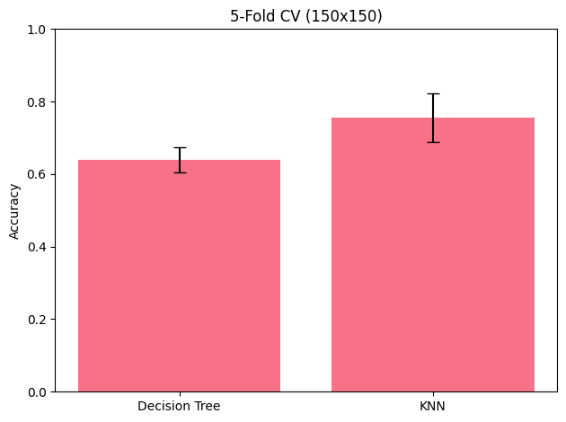
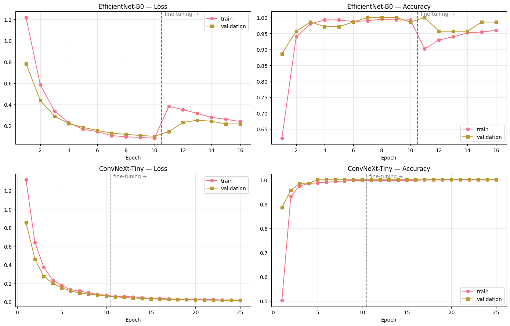

# MUMDMC2025: Mineral Classification Reproduction and Critical Evaluation

**Research reproduction · Classical machine learning · Cross-validation · Hyperparameter tuning · CNN transfer learning · Dataset audit**

This project reproduces the **Decision Tree (DT)** and **k-nearest neighbors (KNN)** methodology reported in *A Photomicrographic Dataset of Rocks for the Accurate Classification of Minerals* (Amer et al., 2025) on an accessible subset of MUMDMC2025. It extends the baseline with five-fold cross-validation, hyperparameter tuning, error analysis, and pretrained CNNs (EfficientNet-B0 and ConvNeXt-Tiny).

**Main finding:** high test-set accuracy on randomly split images does **not** establish performance on independently acquired crystals. The accessible dataset contains correlated rotation-image groups represented in both training and test sets.

## Quick start: Google Colab

**The notebook is designed for Google Colab, not for an unmodified local Jupyter setup.**

1. Open [`notebooks/MUMDMC2025.ipynb`](notebooks/MUMDMC2025.ipynb) in Google Colab (upload it or open it from the repository after publishing).
2. Select **Runtime → Change runtime type → GPU** for faster CNN training; CPU is possible but slower.
3. Ensure internet access (required to download the public image subset and pretrained ImageNet weights).
4. Select **Runtime → Run all**. Run cells from top to bottom without skipping sections.
5. Inspect the displayed results or retrieve CSV/PNG outputs from `/content/outputs/` and CNN checkpoints from `/content/models/` in the Colab session.

The first notebook cells install `gdown`, download the [shared image subset](https://drive.google.com/file/d/1cq-YGOLOZfIrq3T1Nxv_VXJC0aQBR6fh/view), and extract it automatically. There is no need to commit the dataset to GitHub. For the original dataset publication, see [Figshare](https://doi.org/10.6084/m9.figshare.29483204.v1).

The `requirements.txt` file records **reference dependency versions**, but Colab includes its own installed environment. Do not blindly reinstall all pinned packages in an active GPU Colab runtime: overriding its PyTorch build can break GPU compatibility. See [Reproducibility](docs/REPRODUCIBILITY.md).

## Dataset

The paper describes a broad collection of **14,400 photomicrographs** and a publicly described **2,500-image XPL classification sample**. The image archive used for this reproduction contains **583 cropped images** from five classes, across **eight acquisition folders**:

| Mineral | Images | Folders |
| --- | ---: | ---: |
| Biotite | 147 | 2 |
| Hornblende | 73 | 1 |
| Plagioclase | 146 | 2 |
| Potassium-Feldspar | 73 | 1 |
| Quartz | 144 | 2 |
| **Total** | **583** | **8** |

The images are photographs of minerals at different rotation angles; 583 image files are **not** 583 independently identified physical crystals. It is plausible that each folder corresponds to a separate crystal, but this interpretation is **not verified**. Repeated filenames in different folders, and mismatches against separate 2,500-record metadata workbooks, prevent reliable specimen-level identification. See [Dataset audit and limitations](docs/DATASET_AUDIT.md).

## Experimental methodology

| Section | Aim | Method |
| --- | --- | --- |
| Dataset audit | Understand class counts and acquisition groups | Inspect files, class counts, and folder overlap |
| **Experiment 1 — Baseline** | Reproduce the paper's ML approach | Normalized flattened RGB pixels; DT and KNN; 224×224 and 150×150; stratified 80/20 split |
| **Experiment 2 — Cross-validation** | Evaluate split-to-split variability | Stratified 5-fold CV **on the 466 training images only**, 150×150 |
| **Experiment 3 — Tuning** | Choose model settings | KNN `k = [1, 3, 5, 7, 9]`; DT `max_depth = [5, 10, 15, None]`; select via CV Macro-F1 |
| **Experiment 4 — Error analysis** | Investigate errors and within-folder similarity | Confusion matrices, misclassified examples, 1-nearest-neighbor folder analysis |
| **Experiment 5 — CNN** | Compare transfer learning with classic ML | ImageNet-pretrained EfficientNet-B0 / ConvNeXt-Tiny, head training and fine-tuning |

Classic experiments use **466 training / 117 test images**. CNN training uses **396 training / 70 validation / 117 test** images, with the same held-out *image-level* test set. The original-size baseline branch is internally standardized to **224×224** on this subset; it is **not** the native acquisition resolution described in the paper.

Detailed configuration: [Methods](docs/METHODS.md).

## Results (saved Colab run)

| Model / experiment | Accuracy | Macro-F1 | Evaluation |
| --- | ---: | ---: | --- |
| DT (150×150 baseline) | 60.7% | 58.5% | 117-image test |
| KNN, k=5 (150×150 baseline) | 75.2% | 75.2% | 117-image test |
| DT (5-fold CV) | 64.0% ± 3.5 pp | 62.3% | Training-fold validation |
| KNN, k=5 (5-fold CV) | 75.5% ± 6.7 pp | 75.5% | Training-fold validation |
| DT, tuned depth=10 | 60.7% | 58.5% | 117-image test |
| KNN, tuned k=1 | **87.2%** | **87.0%** | 117-image test |
| EfficientNet-B0, fine-tuned | **99.1%** | **99.3%** | 117-image test |
| ConvNeXt-Tiny, fine-tuned | **100%** | **100%** | 117-image test |

Accuracy and Macro-F1 are distinct metrics; the CNN comparison also reports weighted precision, recall, F1 and ROC-AUC. Values above are rounded from **saved outputs in the submitted notebook**, not independently reproduced on a new machine. Additional rows and the 224×224 comparison are available in [`results/`](results/).





## Interpretation and evaluation limitations

- **All 117 test images** belong to acquisition folders also present in the baseline training split.
- For **101 of 117** test images, KNN with `k=1` finds its nearest training image in the **same folder**. Since each folder has one mineral label, these matches are necessarily correct for the 1-NN classifier.
- Under an image-level split, rotation views from the same acquisition group can appear on both sides of training/test. This creates **potential group-level information leakage** when the intended target is unseen physical crystals.
- We have **not** established the number of physically independent crystals, measured the inflation of test accuracy, or conducted a verified crystal-disjoint evaluation.
- Consequently, **100% accuracy on this 117-image test set does not imply 100% accuracy on unseen crystals**.

The reproduction is therefore **partial** (583 images rather than the 2,500-image sample reported in the article), while the additional analyses clarify interpretation of the results.

## Repository contents

```text
.
├── notebooks/MUMDMC2025.ipynb          # Complete Colab notebook, experiments 1–5
├── results/                         # Compact CSV summaries of saved experimental outputs
├── figures/                         # Selected plots exported from notebook results
├── presentation/                    # English slides (PPTX/PDF) and speaker notes
├── data/README.md                   # Source and data-access instructions (no raw images)
├── docs/                             # Methods, data limitations, reproducibility, attribution
├── .github/workflows/notebook-check.yml  # Lightweight syntax and format CI
├── requirements.txt
├── LICENSE                           # MIT code license, upstream attribution retained
└── .gitignore                        # Excludes datasets, model weights and generated files
```

**Important:** the CI workflow checks notebook structure and Python syntax; it does **not** execute training or assert reproducibility of reported performance.

## References and attribution

- Amer, B. G., et al. (2025). *A Photomicrographic Dataset of Rocks for the Accurate Classification of Minerals*. *Scientific Data*. https://doi.org/10.1038/s41597-025-05879-9
- Reference code and original MIT license: https://github.com/MscModelTrain/MUMDMC2025-preprocessing-evaluation
- Dataset publication: https://doi.org/10.6084/m9.figshare.29483204.v1

This repository documents an **adapted methodological reproduction and additional experiments**. The implementation follows the paper and draws on the reference preprocessing/evaluation work, with changes for the available subset and extensions for validation, tuning, error analysis, and CNNs. The software's MIT license **does not cover** external image datasets or pretrained network weights. See [Attribution and licensing](docs/ATTRIBUTION.md).
